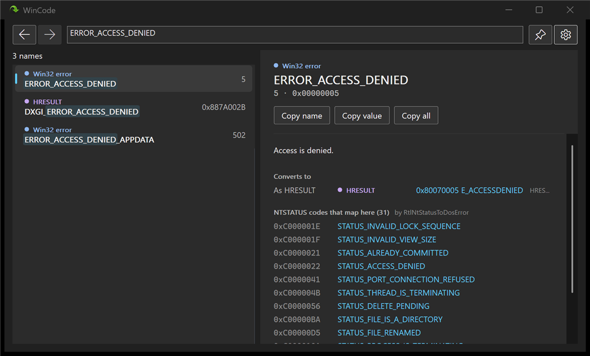
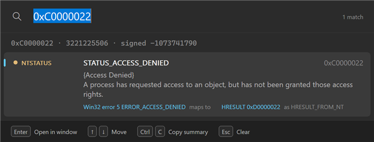
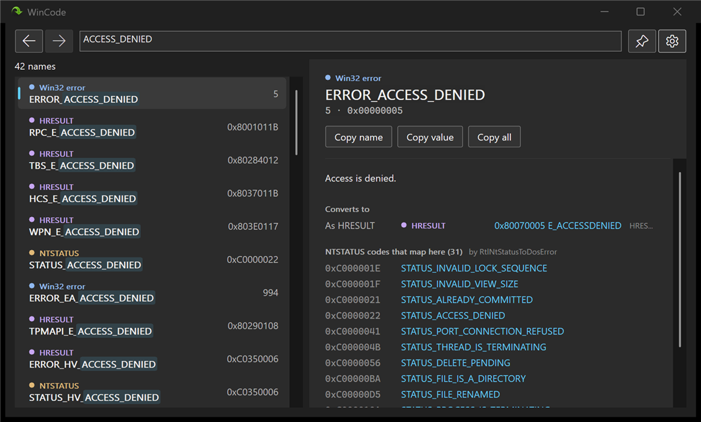

# WinCode

Looks up the numbers that turn up while debugging Windows or reading its logs, in
both user mode and kernel mode: Win32 errors, HRESULTs, NTSTATUS codes, bugchecks
and window messages. One value, every meaning it has, and the codes it converts
to.



## Downloads

From [Releases](https://github.com/gedmurphy/wincode/releases):

| File | For |
|---|---|
| `WinCode-<version>-setup.exe` | Installing per user, with no admin rights |
| `WinCode-<version>-x64.zip` | Running from anywhere: a VM, a test machine, a USB stick |

Neither is signed yet, so Windows warns about an unknown publisher the first time.

The installer puts WinCode in `%LOCALAPPDATA%\Programs\WinCode`, adds it to the
Start menu, and offers to put `wincode` on your PATH and to start WinCode when
you sign in. Uninstalling removes all of it and leaves your settings.

## The window

WinCode waits in the notification area so its hotkey always works. **Win+Shift+E**
opens the popup over whatever you're in, with the clipboard already looked up:



Enter opens the result in the window, Ctrl+C copies it as one line, and Esc
clears then closes. Closing the window hides it; Exit on the tray icon quits.

Every related code is a link. Following one is a new lookup, and Back and Forward
(or Alt+Left and Alt+Right) retrace your steps. The × at the end of the search
box, or Esc, clears it, and Back brings back what was there. Part of a name is enough to
search, and the part that matched is highlighted:



When the results span several kinds of code, chips above the list narrow them to
one. Copy as Markdown gives the selected code ready for a bug report. Add a note
to any code, such as what it means in your own driver, and it's shown whenever
that code comes up again.

Settings, from the gear or the tray icon, change the hotkey, start WinCode at
sign-in, turn the update check off, or clear recent lookups. Codes to show
lists every source of codes, and each can be shown always, only when nothing
else matches, or never, so window messages needn't clutter a kernel developer's
lookups. The update check
asks GitHub once a day for the latest release and offers a newer one from the
tray icon. It's the only network access WinCode makes, and it sends nothing but
the request. They live in `settings.json`, beside the
executable if there's one there and in `%APPDATA%\WinCode` otherwise, so a copy
with its own settings file is portable. The theme follows Windows.

## Your own codes

WinCode can look up your own codes too: your driver's NTSTATUS codes, your
HRESULTs and Win32 errors, and your pool tags. Put the header that defines them
in the `codes` folder beside `settings.json`, or choose Your codes in settings
and Add file to read one where it is, such as in your source tree.

WinCode works out each `#define` itself, with no compiler: casts such as
`((NTSTATUS)0xE0010001L)`, `MAKE_HRESULT` and `_HRESULT_TYPEDEF_`, your own
macros and facilities, and names from the SDK. A four-character constant such
as `'gaTM'` is a pool tag, named as a debugger shows it, and a `CTL_CODE` is an
IOCTL. A comment after a
`#define`, or a message compiler's MessageText block, is its text.

A header is read again whenever it changes. Your codes lists each header with
how many codes it gave and anything it couldn't work out, line by line, and
Treat as says what a header's plain numbers are when how they're written
doesn't. Each header is also a row in Codes to show. The command line reads the
same headers.

## The command line

```
wincode 0xC0000005
wincode -2147024891
wincode "CreateFile failed (HRESULT: 0x80070005)"
wincode ERROR_ACCESS_DENIED
wincode ACCESS_DENIED
```

```
> wincode 0xC0000005
0xC0000005  3221225477  (signed -1073741819)
  NTSTATUS        STATUS_ACCESS_VIOLATION
                  The instruction at 0x%p referenced memory at 0x%p. The memory could not be %s.
                  fields      error, facility 0x0 (0), code 0x0005 (5)
                  maps to     Win32 error 998 ERROR_NOACCESS (RtlNtStatusToDosError)
                  as HRESULT  0xD0000005 (HRESULT_FROM_NT)
```

It takes a value however a log or a debugger writes it: decimal, hex with or
without `0x`, negative decimals, sign-extended 64-bit values, C suffixes, and
codes wrapped in labels and punctuation. Eight decimal digits are read as decimal
and as hex, since that's a code with its `0x` dropped, and whichever means
something is shown.

Each value is looked up as every kind of code it could be, with its message from
this Windows, its fields, and its cross-references: as an HRESULT, the Win32
error an NTSTATUS maps to, the code inside an HRESULT, and for a Win32 error every
NTSTATUS that maps to it. That last one is many to one, and no other tool shows
it: 31 NTSTATUS codes become `ERROR_ACCESS_DENIED`.

Beyond the SDK's error tables (Win32, HRESULT, including Windows Update, audio,
Volume Shadow Copy and the CLR's, NTSTATUS, bugchecks, window messages, Device
Manager problem codes, USB statuses and LDAP results), it knows:

- **Fill patterns and exception codes**, which no header names: `0xCCCCCCCC` is
  uninitialised stack, `0xFEEEFEEE` freed heap, `0xE06D7363` a C++ exception.
  A 64-bit `0xCCCCCCCCCCCCCCCC` counts too.
- **Kernel pool tags**, from the debugger's own list: `MmSt`, or `0x20707249`, the
  way `Irp ` reads in memory. A tag the list only covers with a pattern, like
  `Gh?5`, is found as `Gh05`. In pasted text a tag needs a label, as in
  `Pool tag: Ntfx` or a line from `!pool`, since plenty of tags are words.
- **IOCTLs and FSCTLs**, from the SDK's and the WDK's headers: `0x70000` is
  `IOCTL_DISK_GET_DRIVE_GEOMETRY`, with its device type, function, method and
  access shown.

A value in no table is still explained where its shape says something, such as an
HRESULT with a known facility or a message in the `WM_USER` range. Anything else
says "no match" rather than inventing a meaning.

Give a flag family and a value to decode the value into its named bits:

```
> wincode file 0x120089
0x00120089  1179785
  Flags           File access rights
                  FILE_READ_DATA (FILE_LIST_DIRECTORY) | FILE_READ_EA | FILE_READ_ATTRIBUTES | READ_CONTROL | SYNCHRONIZE
                  Includes FILE_GENERIC_READ.
```

`wincode --flags` lists the families: access rights for files, registry keys,
processes and threads, page protections, memory allocation types, file sharing,
`CreateFile` dispositions, file attributes and flags, and window styles. The same
`file 0x120089` works in the window and the popup.

Any value can be read as an IOCTL, so a plain lookup only shows the ones a header
names. Ask with `ioctl` or `fsctl` to take any value apart, named or not:

```
> wincode ioctl 0x8000E00F
0x8000E00F  2147541007
  IOCTL           CTL_CODE(0x8000, 0x803, METHOD_NEITHER, FILE_READ_ACCESS | FILE_WRITE_ACCESS)
                  fields      device type 0x8000, vendor device type, function 0x803 (2051), vendor function, METHOD_NEITHER, FILE_READ_ACCESS | FILE_WRITE_ACCESS
```

The command line follows the same Codes to show settings as the window, and
`--all` shows every source for one run.

Exit codes: 0 if anything matched, 1 if nothing did, 2 for a usage error.

## Building

Visual Studio 18 with the C++ desktop workload, plus the ARM64 build tools for
ARM64. No .NET, no third-party libraries.

```
cmake --preset x64
cmake --build --preset x64-debug
ctest --preset x64-debug
```

`cmake --build --preset x64-release --target installer` builds the installer and
the zip, which needs [Inno Setup](https://jrsoftware.org/isinfo.php).

| Path | What's in it |
|---|---|
| `Core/` | Parsing, lookup and decoding, with no UI |
| `Cli/` | `wincode.exe` |
| `Gui/` | `WinCodeUI.exe`: the popup, the window and the tray icon |
| `Tests/`, `tools/`, `installer/`, `docs/` | Tests, table generators, the installer script, and the plan |

The tables are generated from the Windows SDK headers by compiling a program that
includes them, so the compiler works out each value. They're committed, so an
ordinary build needs no SDK-specific step. Every binary links the C runtime
statically, so a single file runs on a bare machine.

## Licence

GPLv3 or later. See [LICENSE](LICENSE).
